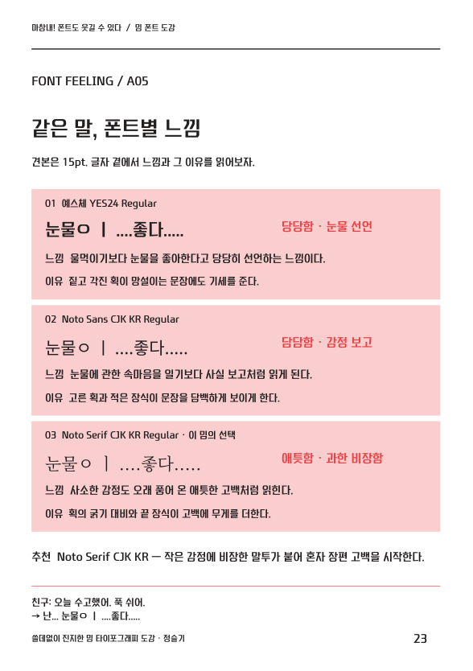

# 6주차 과제 제출 및 출력 파일

책을 A5 세로 **총28쪽, 밈16개**로 구성했습니다. 1쪽은 흰 표지와 선정한 밈 사진, 28쪽은 뒷표지와 출처입니다. 예스체를 기준으로 실제 Noto 고딕·명조를 비교하고, 비스듬한 빨간 스티커·별표·노랑·분홍 면으로 B급 감성을 살렸습니다.

## 새 원고 반영

- 사람 이모지의 ‘웅성웅성’은 책에서 제외하고, 22–23쪽에 ‘가끔은 눈물을 흘린다’를 넣었습니다.
- 26–27쪽에 ‘난 오늘만 산다’, 15쪽에 붙여 쓴 ‘로맨틱한언어들’을 추가했습니다.
- 2쪽에는 ‘야르·밤티·이태민 이태민 이태민’을 실제 사용 예문과 함께 모았습니다.
- 14쪽 ‘내가 감히’는 원문과 서체 비교를 한 면에 통합했습니다. 별도 실험실의 비교는 각 밈의 해설에 포함하고 출처는 뒷표지로 옮겨 총28쪽을 유지했습니다.
- 교수님 이미지 밈은 수록하지 않았습니다.

## 서체별 느낌을 설명하는 개정

큰 글자 대신 **작은 견본과 서체별 느낌 설명**에 공간을 배분했습니다. 해설 제목은18pt, 펼침면의 견본은15pt입니다. 14·15쪽 통합 지면은13.5pt, 2쪽 짧은 말 모음은11pt, 3쪽 입문은16pt로 세 서체를 비교합니다. 각 서체의 **느낌 키워드·읽히는 인상·형태에 근거한 이유**를 함께 보여줍니다.

- 예스체 YES24: 짙고 각진 획이 단호한 기세를 더합니다. 반성하는 문장에서도 기세가 남는 어긋남을 읽을 수 있습니다.
- Noto Sans CJK KR: 고른 획과 절제된 끝맺음이 담담하게 읽힙니다. 황당한 자기비하를 사실처럼 보고하는 웃음을 살립니다.
- Noto Serif CJK KR: 획의 굵기 대비와 끝 장식이 격식을 더합니다. 작은 감정을 장엄한 고백처럼 말하는 과몰입을 보여줍니다.

이 느낌은 책에 실린 문구와 맥락에 대한 해석입니다. 한 비교 안에서는 문구·크기·색·프레임 폭을 맞췄으며, 같은 Regular여도 서체별 실제 획 두께는 다릅니다. 보관 원문은 교정하거나 정규화하지 않았습니다.

## 제출할 파일

- `Planning_28p_GoogleDocs.docx`: 무드보드·서체 선정 근거·페이지별 구성·출력 계획을 포함한 6쪽 기획 보완안입니다.
- `PDF/Meme_Font_Book_28p_A5.pdf`: A5 크기 28페이지의 전체 디자인 PDF입니다. 기본 보기 설정은 책처럼 두 쪽씩 보는 방식입니다.
- `PDF/Meme_Font_Book_28p_Spreads.pdf`: 같은 28쪽을 표지 단면·본문13개 펼침면·뒷표지 단면으로 보여주는 15페이지 검토용 PDF입니다.
- `PDF/Meme_Font_Book_A3_ActualSize.pdf`: A3 가로 14장, A5 펼침면 실제크기, 도련3mm·재단선 포함의 수업 출력용 PDF입니다.

## 기획안을 Google Docs로 제출

Google Docs 문서 자체는 이 작업 환경에서 직접 생성하지 못했습니다. 최종 기획안은 Google Docs로 가져올 수 있도록 DOCX로 만들고, 제목·표·이미지와6쪽 전체 렌더를 검수했습니다.

1. Google Drive에 `Planning_28p_GoogleDocs.docx`를 업로드합니다.
2. 파일을 우클릭해 **연결 앱 → Google 문서**로 엽니다.
3. Word 편집 모드로 열렸다면 **파일 → Google 문서로 저장**을 선택합니다.
4. 변환한 문서의 표와 이미지가 잘 보이는지 확인하고, 수업에서 요구한 공유 범위로 제출합니다.

Google Docs 변환 이후의 지면과 공유 설정은 아직 확인하지 못했습니다. 별도 FigJam 보드 없이 기획안 안에 무드보드를 포함했습니다.

## 출력

`PRINT_GUIDE_KO.md`를 따라 **A3 가로·단면·실제 크기100%**로 출력합니다. PDF의첫 장을 시험 출력해100mm 기준선을 확인하고, 바깥 재단선만 따라 자릅니다. 전체14장을 재단해 가져가면 되며 제본은 선택입니다.

## 편집 가능한 원본과 원문

`editable/`에는 28쪽 IDML, InDesign 안에서 새 INDD를 만드는 JSX와 표지 PNG의Links폴더가 있습니다. 편집 시에는 예스체 YES24 Regular, Noto Sans CJK KR Regular, Noto Serif CJK KR Regular가 필요합니다. 폰트 원본은 재배포하지 않습니다. 실제 InDesign 열기·실행은 미검증이며, 제공한 PDF는 별도 생성·검수한 출력물입니다. IDML을 열 때는 Links 폴더를 함께 유지하세요.

`archive/`의 기존14개 보존 파일은 변경하지 않았습니다. `archive/additions/`에 새 원문6개와 사용 예문·검증 해시를 추가했습니다. 전체 텍스트17개를 보관하며, B04를 제외한16개를 책에 수록했습니다. 눈물 독백의 분리 자모·공백·마침표와 로맨스 독백의 붙여쓰기·마지막 공백2칸까지 보존했습니다. 제외한 B04 원문은 보관에만 남아 있습니다. `layout.json`, `editorial.json`은 별도 편집 데이터입니다.

## 검수 범위

28쪽 A5와14장 A3의 규격, 모든 쪽의 배치, 100%배율, 도련3mm, 외곽 재단선, 표지 이미지, 글꼴 처리와 원문 보존을 검사했습니다. 예스체는 PDF에 하위집합으로 내장했고 Noto 견본과 AA는 실제 글리프의 벡터 윤곽으로 유지했습니다. PDF를 열고 출력할 때 별도 폰트 설치는 필요하지 않습니다.

원문과 PDF는 시각·구조 검수를 마쳤지만, 실제 종이 출력과 Google Docs 업로드·공유 제출은 사용자가 진행해야 합니다. 검수 기록과 파일 해시는 validation 및SHA256SUMS.txt에 있습니다.
